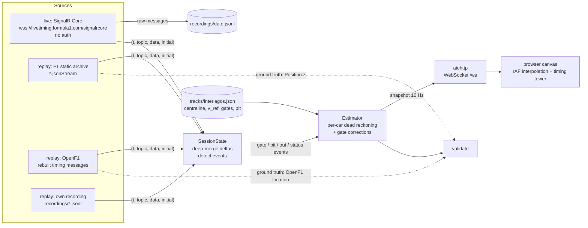

# f1-live-tracker

Hobby project: every F1 car's **estimated** position on a real track map in the browser,
for races and sprints, using only timing data that needs **no login**.

Real GPS positions (`Position.z` / `CarData.z`) need an F1 TV subscription. The free timing
topics (`TimingData`, `LapCount`, `DriverList`, `TrackStatus`, `SessionStatus`, `SessionInfo`,
`TimingAppData`) don't, so positions are estimated from timing events with a dead-reckoning
observer that is corrected by measurement updates.

## Quick start

You need **Python 3.10 or newer** (check with `python3 --version`) and an internet connection the first time.

```bash
git clone https://github.com/Shiva-prasad9/f1-live-tracker.git
cd f1-live-tracker
python3 run.py          # Windows: python run.py
```

1. It sets itself up on the first run (about a minute) and asks what you want:
   - **1 = Replay**: watch the real 2026 São Paulo GP from a saved recording. Works any time, even offline.
   - **2 = Live**: connect to the live F1 timing feed. Cars show up while a session is running.
2. It prints a link, **http://localhost:8000**, and opens it in your browser.
3. **Ctrl+C** in the terminal to stop.

Skip the question with `python3 run.py replay` or `python3 run.py live`.

In the page:
- **Replay:** speed buttons (1x to 50x), pause (`Space`), restart (⟲).
- **Hover** a car or a name in the table for its lap times, gap and tyres. **Click** to pin it.
- **B** switches the background effects off. Add `?wx=rain` to the link to preview the rain effect.

### Trouble?
- *"python3: command not found"*: install Python from https://www.python.org/downloads/ (on Windows tick "Add python.exe to PATH").
- *Live shows a finished or empty session*: nothing is running right now. Use Replay, or try again on a race weekend.
- *Port 8000 busy*: it picks the next free port and prints the link, or pass `--port 9000`.
- *Positions look a bit off*: they are **estimates** from timing data (no GPS needed), typically within about 40 m, see "Real race" below.

## For developers

```bash
python3 -m venv .venv && source .venv/bin/activate
pip install -r requirements-dev.txt      # adds pytest + matplotlib
pytest                                   # 21 tests

python -m tracker live                                   # same as run.py live
python -m tracker replay --file replays/sao-paulo-2026-race.jsonl.gz --speed 10 --start 0
python -m tracker replay --year 2025 --event "São Paulo Grand Prix" --session Race   # rebuilt from OpenF1 (needs internet, not during a live session)
python -m tracker validate --year 2025 --event "São Paulo Grand Prix" --session Race # error vs real GPS, writes a plot
python -m tracker build-track --circuit Interlagos       # tracks/interlagos.json is committed
```

Live mode saves every raw feed message to `recordings/<date>.jsonl` (git-ignored); replay it with
`python -m tracker replay --file recordings/<date>.jsonl`. `replays/` holds the bundled recording.

## Race-day checklist (São Paulo GP)

1. `python3 run.py live` **about 15 minutes before lights out**.
   The log should show `subscribed: DriverList, …, TimingData, …` and `session: São Paulo Grand Prix Race`.
2. Open http://localhost:8000. Before the start the cars sit on the grid in grid order.
3. At the start the log prints `race start at …`. If it also prints `race start corrected …`, the
   `Started` status marked the formation lap; cars are re-launched from the start time implied by
   the first sector-1 time (a one-off jump about 25 s after lights out).
4. If the page freezes: the client reconnects by itself (watch for `reconnecting` in the log). The
   page reconnects to the server by itself too, so a browser refresh is all you need.
5. If anything breaks, the raw feed is in `recordings/<UTC date>.jsonl` (every message, as received).
   Fix, then replay it: `python -m tracker replay --file recordings/2026-11-08.jsonl --speed 10`.
6. If you start mid-race, cars are placed after their last completed sector and snap into place at
   their next sector event (≤ ~30 s).

## Architecture



| Module | Role |
|---|---|
| `tracker/sources/live.py` | SignalR Core client (mirrors FastF1 3.9 `livetiming/client.py` without the F1-account token): pre-negotiate for the `AWSALBCORS` cookie, `Subscribe`, hub method `feed`, auto-reconnect, raw recording |
| `tracker/sources/archive.py` | F1 static archive: `Index.json` → meeting → session `Path` → `<Topic>.jsonStream`; `Position.z` decoding (base64 + raw deflate) for validation |
| `tracker/sources/openf1_replay.py` | Fallback replay: rebuilds live-format messages from OpenF1 laps/positions/intervals/pits/stints/race control |
| `tracker/merge.py`, `tracker/state.py` | Deep merge of partial updates (incl. `"0","1",…`-keyed lists), event detection |
| `tracker/track.py`, `tracker/trackbuild.py` | Track model and its builder from OpenF1 |
| `tracker/estimator.py` | The observer |
| `tracker/server.py`, `web/` | Server, replay/live loops, front end |
| `tracker/validate.py` | Error vs real positions |

## The estimator

State per car: race distance `D = lap·L + s` and pace factor `k`.

- **Predict:** `ds/dt = k · f · v_ref(s)`, implemented exactly as reference time:
  `τ(D) += k·f·dt`, where `v_ref` comes from a clean fast lap. `f = 0.6` under SC/VSC (`TrackStatus` 4/6/7)
  and 0 under a red flag.
- **Measurements:** a `TimingData` `Sectors[i].Value` that changes to a new non-empty value means the car
  passed gate `i+1` (S1 end, S2 end, line). A `NumberOfLaps` increment is also a line crossing.
  Duplicates within 3 s are dropped. An identical value re-sent more than 20 s after the last crossing still
  counts (the same sector time to the millisecond happens).
- **Crossing time:** the message timestamp, refined with the sector-time chain:
  `t_cross = min_n(t_msg_n − Σ sector times) + Σ sector times`. This removes feed jitter, though not a
  constant latency floor.
- **Correction:** the measured position, propagated to "now", is blended in with τ = 0.5 s (~95% in 1.5 s).
  A car never moves backwards; when it's ahead of the measurement it slows to as little as 15% speed.
  Errors > 400 m snap (rejoin/reconnect).
- **Pace:** `k ← 0.6k + 0.4·(ref sector time / measured sector time)`, clamped to 0.85–1.10, only from green,
  non-out-lap sectors that started at a measured gate.
- **Gate hold:** from 80 m past an unreported gate the car decelerates and stops at +120 m (crash, spin, slow lap).
- **Start:** before `Started` the cars sit on the grid (8 m per slot, ±3 m stagger). After it they launch at
  10 m/s² capped by `v_ref`. The first lap-1 S1 time confirms the start (see checklist).
- **Pits:** `InPit` → drawn moving along the pit lane. `InPit` false → rejoin at pit exit with `k·0.92` until
  the next gate.
- **Retired/Stopped** → grey, in the OUT list.
- **No gate event yet** (joined mid-session): the car is placed at its last completed sector, then follows
  "where the leader was `GapToLeader` seconds ago" (2.5 min of leader history) until its own first gate.
  `+1 LAP` gaps don't use this.
- **Order:** a car is never drawn ahead of (or within 6 m of) the car in front of it in `Position`.

## Validation

### Data access status (7 Nov 2026)

- **Live feed:** works without a login (verified during São Paulo qualifying: full initial state and
  deltas for all the timing topics; `Position.z` is not delivered).
- **F1 static archive** (`livetiming.formula1.com/static/…`): **returns 401 to anonymous requests.**
  FastF1 3.9 now signs in with an F1 account for it, and its public mirror
  (`livetiming-mirror.fastf1.dev`) returned 404 for every path tried. `--source archive` is implemented to
  the spec and will work if the archive reopens. With `--source auto` (default) it falls back to OpenF1.
- **OpenF1** (`api.openf1.org`): free and no login for historical data, **except while a live F1 session is
  running**, when the whole API needs a paid key.

So the replay validation uses **OpenF1**: timing messages are rebuilt from OpenF1 laps/sectors, with a
1.0 ± 0.3 s feed latency added. Ground truth is **OpenF1 `location`**, the same x/y signal as `Position.z`
at ~3.7 Hz.

### Synthetic test (`tests/test_synthetic.py`)

20 cars on the reference profile, pace spread ~2.3%, ±1.5% random pace per sector, feed latency
0.3–1.0 s, one pit stop, one car stopping on track:

| | mean | p95 | max |
|---|---|---|---|
| lap 1 | 31–37 m | 65–76 m | 94–106 m |
| laps 2+ | 22–24 m | 43–47 m | 82–108 m |

The spec's target was "error below 50 m". That holds for p95 but **not for the maximum**. The residual is the
injected sector-to-sector pace noise (up to ±0.36 s per sector) plus the 0.3 s latency floor (a constant
~20 m lag). Gate events alone can't reveal either, so the test asserts p95 < 50 m and max < 120 m
(lap 1: p95 < 100 m).

### Real race: 2025 São Paulo GP

Replay of the real 2025 race through the same pipeline (`python -m tracker validate --year 2025
--event "São Paulo Grand Prix" --session Race`). Timing messages are rebuilt from OpenF1 lap/sector data
with a simulated 1.0 ± 0.3 s feed latency; ground truth is OpenF1 GPS location projected onto the
centreline. The error is measured on the *drawn* position (what the page shows). 190,821 samples, every
0.5 s per car on track:

| | mean | median | p95 | p99 | within 50 m | within 100 m |
|---|---|---|---|---|---|---|
| all cars | 66.8 m | 41.6 m | 203 m | 511 m | 61 % | 90 % |

- **The `< 50 m` target is not met** (61 % of samples; the synthetic test also misses it for the maximum).
  Typical error is ~40 m; 90 % of the time a car is drawn within 100 m of its real position.
- **Bias −55 m** (drawn behind the truth) is almost exactly the simulated 1 s latency at ~190 km/h; the real
  latency of the live feed is unknown (see limitations).
- **Tail:** 0.6 % of samples from cars still running are above 600 m. The worst cases are cars that stopped
  on track: the replay only reports them retired much later than the live feed would, and the estimator has
  no other stop signal, so it keeps driving them to the next gate and holds them there (cars 5 and 16 here).
- **Bug found by this run and fixed:** the "never draw a car ahead of the car in front" constraint used a
  stale `Position` order (e.g. right after a pit exit) and dragged every car behind it back by up to half a
  lap for ~10 s. It now only nudges violations below 80 m. This took the mean from 141 m to 67 m and p95
  from 701 m to 203 m.

## Known limitations

- **Accuracy is bounded by the gates:** only 3 measurements per lap. Between gates the car follows
  a reference lap scaled by its recent pace, so lifts, battles, traffic and mistakes are invisible until the next gate.
- **Feed latency floor is unknown:** the live feed's delay between a car crossing a gate and the message
  timestamp is not observable without GPS. The jitter is removed, the constant part isn't
  (`ASSUMED_LATENCY` in `estimator.py`, default 0).
- **Lap 1** has no pace information; cars follow the reference profile from a standing start.
- **SC/VSC** uses a fixed 0.6 speed factor; behind the safety car, cars bunch up in ways this doesn't model.
- **Pit lane** drawing is time-based (22 s traversal), not measured.
- **`SessionStatus: Started` semantics** in races (lights out vs formation lap) couldn't be checked against
  the archive; see the start confirmation above.
- **Track models:** only `tracks/interlagos.json` is committed. Other circuits need
  `python -m tracker build-track --circuit <OpenF1 circuit_short_name>`, run while no live session is on.
- **Mini-sectors:** `Sectors[i].Segments[j].Status` changes probably mark mini-sector passes (~20 per lap). Using
  them as extra gates would likely cut the error a lot but needs their positions (future work).
